# MEntee Architecture & Design Diagrams

This directory contains the system architecture diagram, database schema diagram (ERD), and overall data flow diagram (DFD) for the **MEntee (Institutional Mentor–Mentee Management System)**.

---

## Directory Structure & Formats

| Diagram | Draw.io Native Format (`.drawio`) | Mermaid Markdown Format (`.mmd`) |
| :--- | :--- | :--- |
| **1. System Architecture** | [`system_architecture.drawio`](file:///d:/MEntee/images/system_architecture.drawio) | [`system_architecture.mmd`](file:///d:/MEntee/images/system_architecture.mmd) |
| **2. Database Schema (ERD)** | [`database_schema.drawio`](file:///d:/MEntee/images/database_schema.drawio) | [`database_schema.mmd`](file:///d:/MEntee/images/database_schema.mmd) |
| **3. Overall Data Flow (DFD)** | [`overall_data_flow.drawio`](file:///d:/MEntee/images/overall_data_flow.drawio) | [`overall_data_flow.mmd`](file:///d:/MEntee/images/overall_data_flow.mmd) |

> [!TIP]
> **How to Open & Export via Draw.io:**
> 1. Visit **[app.diagrams.net](https://app.diagrams.net/)** (or install the VS Code *Draw.io Integration* extension).
> 2. Open any `.drawio` file directly.
> 3. To export as high-resolution image for project reports or prints: Select **File → Export as → PNG / JPG / PDF**.

---

## 1. System Architecture Diagram

```mermaid
graph LR
    %% MEntee System Architecture (Minimal, Professional & Print-Friendly)

    subgraph CLIENT["Client Presentation Tier (React 18 + Vite)"]
        direction TB
        USERS["Stakeholders<br/>Student | Mentor | HOD | Admin"]
        VIEWS["Role Dashboards (Tailwind CSS)<br/>• Mentee Hub (Profile, Marks, Vault)<br/>• Mentor Console (Roster, Review Queue)<br/>• HOD Allocation Portal<br/>• Advising Meetings & Minutes"]
        SERVICES["Client Services<br/>• AuthContext (JWT Sync)<br/>• Axios Client (withCredentials)<br/>• File Upload Handler<br/>• SGPA/CGPA Calculators"]
        USERS --> VIEWS --> SERVICES
    end

    subgraph GATEWAY["API Gateway & Security"]
        direction TB
        GATE["HTTPS / RESTful API<br/>• HttpOnly JWT Cookies<br/>• CORS Origin Whitelist<br/>• Zero-Trust Privacy Sandbox"]
    end

    subgraph BACKEND["Application Tier (Node.js + Express.js)"]
        direction TB
        MID["Middleware Pipeline<br/>• CORS & Body Parsers<br/>• JWT & RBAC Route Guard<br/>• Multer Multipart Engine"]
        CTRL["Controllers & Business Logic<br/>• Auth & Users (/api/auth)<br/>• Student Profile (/api/profile)<br/>• Academic Engine (SGPA/CGPA)<br/>• Document Vault (/api/documents)<br/>• Document Requests (/api/doc-reqs)<br/>• Mentorship Allocation (/api/hod)<br/>• Mentoring Sessions (/api/meetings)<br/>• Notes & Tasks (/api/notes)<br/>• Notification Engine (/api/notifications)"]
        MID --> CTRL
    end

    subgraph STORAGE["Data & Storage Tier"]
        direction TB
        DB[("MongoDB (Mongoose ODM)<br/>• users & studentprofiles<br/>• academicrecords & audits<br/>• documents & requests<br/>• mentoringmeetings & minutes<br/>• mentornotes & tasks<br/>• notifications & departments")]
        FILES["File Storage<br/>• Cloudinary CDN (Primary)<br/>• Local Disk Sandbox (/uploads)<br/>• Zero-Trust File Access Control"]
    end

    %% Connections
    SERVICES -->|HTTPS REST| GATE
    GATE -->|Authorized Requests| MID
    CTRL -->|Mongoose Queries| DB
    CTRL -->|Stream File Binary| FILES

    %% Styles
    classDef clientStyle fill:#EFF6FF,stroke:#3B82F6,stroke-width:1.5px,color:#1E3A8A;
    classDef gateStyle fill:#FEF3C7,stroke:#F59E0B,stroke-width:1.5px,color:#92400E;
    classDef backStyle fill:#F0FDF4,stroke:#22C55E,stroke-width:1.5px,color:#166534;
    classDef storeStyle fill:#FAF5FF,stroke:#A855F7,stroke-width:1.5px,color:#581C87;

    class CLIENT,USERS,VIEWS,SERVICES clientStyle;
    class GATEWAY,GATE gateStyle;
    class BACKEND,MID,CTRL backStyle;
    class STORAGE,DB,FILES storeStyle;
```



---

## 2. Database Schema Diagram (Entity-Relationship Diagram)

```mermaid
erDiagram
    %% MEntee Database Schema Entity-Relationship Diagram (Mermaid ERD)

    User ||--o| StudentProfile : "has profile (1:1)"
    User ||--o{ StudentProfile : "mentors mentees (1:N)"
    User ||--o{ AcademicRecord : "owns marks records (1:N)"
    User ||--o{ Document : "uploads/owns documents (1:N)"
    User ||--o{ Document : "reviews documents (1:N)"
    User ||--o{ DocumentRequest : "initiates/receives requests (1:N)"
    User ||--o{ MentoringMeeting : "attends session (1:N)"
    User ||--o{ MentorNote : "writes/receives notes (1:N)"
    User ||--o{ MentoringTask : "assigns/completes tasks (1:N)"
    User ||--o{ Notification : "receives alerts (1:N)"
    User ||--o| Department : "leads as HOD (1:1)"
    DocumentRequest ||--o| Document : "fulfilled by (1:1)"

    User {
        ObjectId _id PK
        string name
        string email UK
        string password
        string role "ADMIN | HOD | MENTOR | MENTEE"
        string department
        string designation
        string avatar
        string status "ACTIVE | INACTIVE"
        date createdAt
        date updatedAt
    }

    StudentProfile {
        ObjectId _id PK
        ObjectId user FK "Unique link to User"
        string studentId "USN"
        string registerNo
        string phone
        string dob
        string gender
        string bloodGroup
        string address
        string department
        string batch
        number semester
        string section
        number cgpa
        number backlogs
        ObjectId mentor FK "Active Mentor User ID"
        date mentorAssignedAt
        ObjectId mentorAssignedBy FK
        array assignmentHistory "Past mentors & reasons"
        number attendancePercentage
        string status "EXCELLENT | ON_TRACK | AT_RISK"
        string riskReason
        object career "Goal, Domain, Target Companies"
        object skills "Programming, Frameworks, Cloud"
        number profileCompletion
    }

    AcademicRecord {
        ObjectId _id PK
        ObjectId student FK "Reference to Student User"
        number semester "1 - 12"
        string academicYear
        array subjects "Code, Name, Credits, Marks, Grade"
        number sgpa
        number totalMarks
        number maxMarks
        number percentage
        number credits
        string status "DRAFT | SUBMITTED | VERIFIED"
        ObjectId lastModifiedBy FK
        string lastModifiedRole
        array auditHistory "Change reason, old & new values"
    }

    Document {
        ObjectId _id PK
        ObjectId student FK "Target Student User"
        ObjectId uploadedBy FK "Uploader User"
        string originalFilename
        string displayName
        string documentType "Marks Card | Certificate | Resume | ID"
        string description
        string mimeType
        number fileSize
        string storageProvider "cloudinary | local"
        string storageId
        string secureUrl
        ObjectId documentRequest FK "Associated Request"
        string reviewStatus "PENDING_REVIEW | APPROVED | REJECTED"
        ObjectId reviewedBy FK
        date reviewedAt
        string reviewComment
        string rejectionReason
        array reviewHistory
    }

    DocumentRequest {
        ObjectId _id PK
        ObjectId student FK "Target Mentee User"
        ObjectId mentor FK "Requesting Faculty User"
        string title
        string documentType
        string description
        string priority "LOW | MEDIUM | HIGH | URGENT"
        date dueDate
        boolean isRequired
        string status "PENDING | UPLOADED | UNDER REVIEW | APPROVED | REJECTED"
        ObjectId submittedDocument FK "Fulfilling Document"
        array reviewHistory
    }

    MentoringMeeting {
        ObjectId _id PK
        ObjectId student FK "Mentee Participant"
        ObjectId mentor FK "Mentor Host"
        string title
        string purpose
        string agenda
        string date
        string startTime
        string endTime
        number duration "Minutes"
        string type "IN_PERSON | VIRTUAL | ONLINE"
        string venue
        string meetingUrl
        string status "SCHEDULED | CONFIRMED | COMPLETED | CANCELLED | RESCHEDULED"
        string discussionPoints "Minutes of Meeting"
        string studentConcerns
        string mentorObservations
        string actionItems
        string followUpDate
    }

    MentorNote {
        ObjectId _id PK
        ObjectId student FK
        ObjectId mentor FK
        string title
        string discussion
        string actionRequired
        string date
        string tag
    }

    MentoringTask {
        ObjectId _id PK
        ObjectId student FK
        ObjectId assignedBy FK
        string title
        string description
        string priority "LOW | MEDIUM | HIGH | URGENT"
        string dueDate
        string status "PENDING | IN_PROGRESS | COMPLETED"
        number progress "0 - 100%"
    }

    Department {
        ObjectId _id PK
        string name
        string code UK
        ObjectId hod FK
    }

    Notification {
        ObjectId _id PK
        ObjectId recipient FK
        string title
        string message
        string type
        boolean read
        date createdAt
    }
```



---

## 3. Overall Data Flow Diagram (DFD Level 1)

```mermaid
graph TD
    %% MEntee Overall Data Flow Diagram (Level 1 DFD & Operational Lifecycle)

    %% External Entities
    EE_STU["Mentee (Student)"]
    EE_MEN["Faculty Mentor"]
    EE_HOD["Head of Dept (HOD)"]
    EE_CLOUD["Cloudinary Storage / CDN"]

    %% Processes
    P1["1.0 Authentication & Session Control<br/>(Bcrypt Hashing, HttpOnly JWT, RBAC)"]
    P2["2.0 Student 360° Profile Management<br/>(Bio, Career Goals, Skills & Portfolio)"]
    P3["3.0 Mentorship Allocation & Workload<br/>(Filter Unassigned, Quotas 12/25, Reassign Audit)"]
    P4["4.0 Academic Performance & Audit Engine<br/>(Marks Entry, Credits, SGPA/CGPA, Mark Audits)"]
    P5["5.0 Document Vault & Verification Pipeline<br/>(Requests, Multer Multipart Stream, Review Workflow)"]
    P6["6.0 Mentoring Sessions & Lifecycle<br/>(In-person/Virtual Schedule, Minutes, Action Items)"]
    P7["7.0 Notification & Event Dispatcher<br/>(In-app alerts, bell center, status triggers)"]

    %% Data Stores
    D1[("D1: User Accounts & Auth (users)")]
    D2[("D2: Student Profiles & Allocations (studentprofiles)")]
    D3[("D3: Academic Marks & Audits (academicrecords)")]
    D4[("D4: Document Vault & Metadata (documents)")]
    D5[("D5: Document Requests (documentrequests)")]
    D6[("D6: Mentoring Meetings & Minutes (mentoringmeetings)")]
    D7[("D7: Notifications Queue (notifications)")]

    %% Data Flows
    %% Auth Flows
    EE_STU -->|1. Credentials / Sign-up| P1
    EE_MEN -->|1. Faculty Login| P1
    EE_HOD -->|1. Admin / HOD Login| P1
    P1 <-->|Read / Write Auth Tokens| D1

    %% Profile Flows
    EE_STU -->|2. Bio, Career Aspiration, Skills| P2
    P2 -->|Save Profile & Portfolio| D2

    %% HOD Allocation Flows
    EE_HOD -->|3. View Unassigned Students & Quotas| P3
    P3 <-->|Query Capacity & Update Active Mentor| D2
    P3 -->|Dispatch Allocation Event| P7

    %% Academic Engine Flows
    EE_STU -->|4. Input Subject Marks & Credits| P4
    P4 -->|Store SGPA, CGPA & Calculated Results| D3
    EE_MEN -->|4. Verify Marks / Log Audit Reason| P4

    %% Document Pipeline Flows
    EE_MEN -->|5. Issue Formal Document Request| P5
    P5 -->|Create Request Record| D5
    D5 -.->|Trigger Mentee Alert| P7
    EE_STU -->|5. Upload Requested / Vault Document| P5
    P5 -->|Stream File Binary| EE_CLOUD
    P5 -->|Store File Metadata & Status| D4
    P5 -->|Update Fulfillment Link| D5
    EE_MEN -->|5. Approve / Reject with Feedback| P5
    P5 -->|Log Review Outcome| D4
    P5 -.->|Dispatch Review Result| P7

    %% Advising Meetings Flows
    EE_MEN -->|6. Schedule Meeting (Topic, Agenda, Link)| P6
    P6 -->|Persist Appointment| D6
    P6 -.->|Invite Notification| P7
    EE_MEN -->|6. Record Discussion Minutes & Actions| P6
    P6 -->|Save Meeting Minutes & Follow-up| D6

    %% Notifications Flows
    P7 -->|Write In-App Notification| D7
    P7 -->|Push Alert to Mentee Bell Icon| EE_STU
    P7 -->|Push Alert to Mentor Bell Icon| EE_MEN

    %% Styling
    classDef entityStyle fill:#DBEAFE,stroke:#1D4ED8,stroke-width:2px,font-weight:bold,color:#1E3A8A;
    classDef processStyle fill:#FEF3C7,stroke:#D97706,stroke-width:2px,font-weight:bold,color:#92400E;
    classDef storeStyle fill:#F3E8FF,stroke:#7E22CE,stroke-width:2px,color:#581C87;

    class EE_STU,EE_MEN,EE_HOD,EE_CLOUD entityStyle;
    class P1,P2,P3,P4,P5,P6,P7 processStyle;
    class D1,D2,D3,D4,D5,D6,D7 storeStyle;
```
